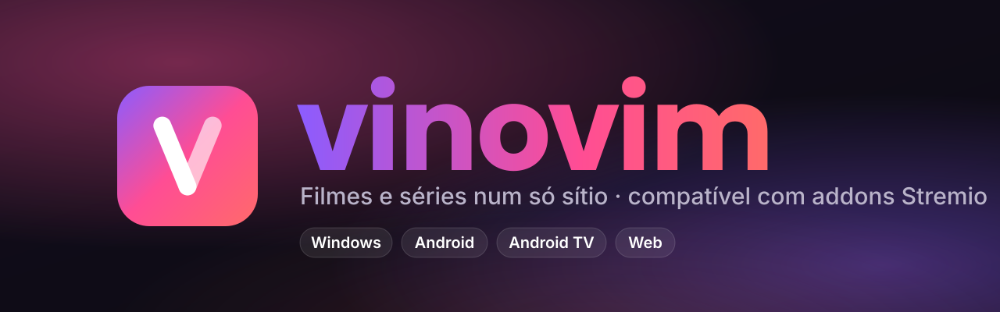
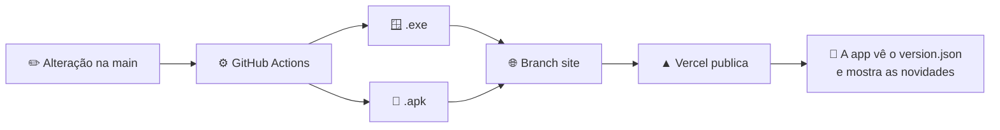

<div align="center">



<br>

[](https://github.com/vitinv1t/vinovim/actions/workflows/build.yml)


**Um hub de filmes e séries bonito, rápido e pessoal — ao estilo Netflix — que funciona com addons do Stremio.**

[🌐 Abrir no browser](https://vinovim.vercel.app/?web) ·
[📥 Descarregar](https://vinovim.vercel.app/download) ·
[📝 Novidades](CHANGELOG.md) ·
[📚 Documentação](docs/)

</div>

---

> [!IMPORTANT]
> O **vinovim não aloja, não vende e não distribui filmes nem séries.** É apenas um leitor e organizador: mostra catálogos e reproduz conteúdo vindo dos **addons que tu instalas**. Cada pessoa é responsável pelos addons que usa e por respeitar as leis do seu país. Lê o [aviso legal](#️-aviso-legal).

## 📖 Índice

- [✨ Funcionalidades](#-funcionalidades)
- [📥 Instalar](#-instalar)
- [🧩 Como funcionam os addons](#-como-funcionam-os-addons)
- [🗂️ Estrutura do projeto](#️-estrutura-do-projeto)
- [🛠️ Desenvolver e compilar](#️-desenvolver-e-compilar)
- [🔄 Como chegam as atualizações](#-como-chegam-as-atualizações)
- [🤝 Contribuir](#-contribuir)
- [⚖️ Aviso legal](#️-aviso-legal)

---

## ✨ Funcionalidades

<table>
<tr>
<td width="50%" valign="top">

### 🎬 Ver
- ▶️ Leitor próprio com legendas e retomar onde paraste
- ⏩ Saltar introdução e enviar para o Chromecast
- ⏭️ Próximo episódio automático com contagem decrescente
- 🖼️ Mini-player e imagem-em-imagem (PiP)
- 🎞️ Trailer a tocar no destaque e pré-visualização ao passar o rato
- 🍿 No fim de um filme, 3 sugestões parecidas
- ⬇️ Transferências para ver sem internet

</td>
<td width="50%" valign="top">

### 🧭 Descobrir
- 🏆 Top 10 de filmes e séries do dia
- 💡 Filas “Porque viste…” e para o teu momento do dia
- 🎯 “% para ti”: quanto cada título combina contigo
- 🆕 Separador **Novidades** com estreias e botão “Avisa-me”
- ⭐ Filtros por género, ano e “Mais bem avaliados”
- 🎲 “Não sei o que ver” e “Surpreende-me”
- 🎭 Página de cada ator com a filmografia

</td>
</tr>
<tr>
<td valign="top">

### 👤 Pessoal
- 👨‍👩‍👧 Até 6 perfis com foto, cor e **PIN**
- 🧒 Perfil infantil (só animação e família)
- 📌 “A minha lista”, notas e listas partilhadas
- 📊 Estatísticas e o teu ano em formato **Wrapped**
- 🏅 Conquistas
- 🔁 Importar do Trakt e do Letterboxd

</td>
<td valign="top">

### 💻 Em todo o lado
- 🪟 **Windows**: “Continuar a ver” no menu Iniciar e controlos na barra de tarefas
- 🤖 **Android**: widget “Continuar a ver” e pesquisa por voz
- 📺 **Android TV**: navegação com o comando
- 🎮 Comando de jogos e atalhos de teclado
- 📱 Usa o telemóvel como comando
- ☁️ Cópia de segurança e sincronização da conta
- 🎮 Estado no **Discord** (opcional)
- 🌍 Em português, inglês e espanhol

</td>
</tr>
</table>

---

## 📥 Instalar

| Plataforma | Como instalar |
|:--|:--|
| 🪟 **Windows** | Descarrega o `vinovim-setup.exe` em **[vinovim.vercel.app/download](https://vinovim.vercel.app/download)** e segue o instalador. |
| 🤖 **Android / Android TV** | Descarrega o `vinovim.apk` na mesma página. Pode ser preciso permitir “instalar apps de fontes desconhecidas”. |
| 🌐 **Browser** | Abre **[vinovim.vercel.app/?web](https://vinovim.vercel.app/?web)**. Também dá para instalar como app (PWA). |

> [!TIP]
> Só precisas de instalar uma vez. As novidades chegam sozinhas: a app avisa-te quando há uma versão nova.

---

## 🧩 Como funcionam os addons

O vinovim fala o **protocolo de addons do Stremio**. Um addon é só um endereço que responde com JSON:

```text
https://exemplo-de-addon.com/manifest.json          → quem é o addon e o que oferece
https://exemplo-de-addon.com/catalog/movie/top.json → listas de filmes ou séries
https://exemplo-de-addon.com/meta/movie/tt0111161.json → detalhes de um título
https://exemplo-de-addon.com/stream/movie/tt0111161.json → onde reproduzir
```

1. Vai a **Mais → Addons**.
2. Cola o endereço do `manifest.json` do addon e carrega em **Instalar**.
3. Os catálogos aparecem no início e as fontes aparecem quando abres um título.

O **Cinemeta** (catálogos e informação dos títulos) vem instalado por defeito. Mais detalhes em [docs/ADDONS.md](docs/ADDONS.md).

---

## 🗂️ Estrutura do projeto

```text
vinovim/
├── 📁 app/                     → a app (igual em todas as plataformas)
│   ├── index.html              → núcleo: ecrãs, leitor, perfis, addons
│   ├── download.html           → página de downloads do site
│   ├── sw.js                   → service worker (abre mesmo sem rede)
│   ├── manifest.webmanifest    → dados da app instalável (PWA)
│   ├── icon.svg                → logótipo
│   └── 📁 js/                  → módulos que acrescentam funções por versão
│       ├── modulo-1.3.js       → sincronização, calendário, estatísticas, ver juntos
│       ├── modulo-1.4.js       → perfil infantil, transferências, temas, conquistas
│       ├── modulo-1.5.js       → avatares, listas partilhadas, notas, atalhos
│       ├── modulo-1.6.js       → Windows (menu Iniciar / barra de tarefas) e Wrapped
│       ├── modulo-1.7-netflix.js → abertura, trailers, Top 10, Novidades, % para ti
│       └── modulo-1.7-visual.js  → menu no topo, menu “Mais”, separadores
├── 📁 desktop/                 → app de Windows (Electron)
│   ├── main.js
│   └── preload.js
├── 📁 mobile/                  → extras do Android (widget, microfone)
│   └── android_widget.py
├── 📁 server/                  → funções do site no Vercel
│   ├── 📁 api/
│   │   ├── account.js          → contas, sincronização e cópias de segurança
│   │   └── lists.js            → listas partilhadas
│   ├── package.json
│   └── vercel.json
├── 📁 scripts/
│   └── make_icons.py           → gera todos os ícones a partir do logótipo
├── 📁 config/
│   └── remote.json             → endereço do site que as apps carregam
├── 📁 docs/                    → documentação
├── 📁 .github/                 → compilação automática e modelos de issues
├── capacitor.config.json       → configuração do Android
├── package.json                → dependências e configuração do .exe
├── version.json                → versão atual e notas (a app lê isto)
└── CHANGELOG.md                → histórico de versões
```

Como as peças encaixam: [docs/ARQUITETURA.md](docs/ARQUITETURA.md).

---

## 🛠️ Desenvolver e compilar

**Correr no browser**, sem instalar nada:

```bash
npx serve app
# abre http://localhost:3000/?web
```

**Compilar tudo** acontece sozinho: cada alteração na branch `main` põe a correr o GitHub Actions, que:

1. 🪟 compila o **.exe** de Windows;
2. 🤖 compila o **.apk** de Android;
3. 🌐 publica o site e os downloads em **vinovim.vercel.app**.

Passo a passo para compilar no teu computador: [docs/COMPILAR.md](docs/COMPILAR.md).

---

## 🔄 Como chegam as atualizações



As apps de Windows e Android carregam a interface a partir do site. Por isso, quase todas as novidades chegam **sem reinstalar**. Só quando muda a parte nativa (`desktop/`, `mobile/`) é que a app pede para instalar a versão nova.

---

## 🤝 Contribuir

Sugestões e correções são bem-vindas! 💜

- 🐞 Encontraste um problema? [Abre um issue de bug](../../issues/new?template=bug_report.md).
- 💡 Tens uma ideia? [Sugere uma funcionalidade](../../issues/new?template=feature_request.md).
- 🔧 Queres programar? Lê o [guia para contribuir](.github/CONTRIBUTING.md).

---

## ⚖️ Aviso legal

O vinovim é um **leitor e organizador de conteúdo**. Não aloja, não indexa, não carrega e não distribui filmes, séries ou outros conteúdos protegidos. Toda a informação e todas as fontes vêm de **addons de terceiros** que o utilizador escolhe instalar e que **não têm ligação** a este projeto.

O projeto não apoia a pirataria. Usa o vinovim apenas com conteúdo a que tenhas direito de aceder.

---

<div align="center">

Feito com 💜 por **vitinv1t**

</div>
