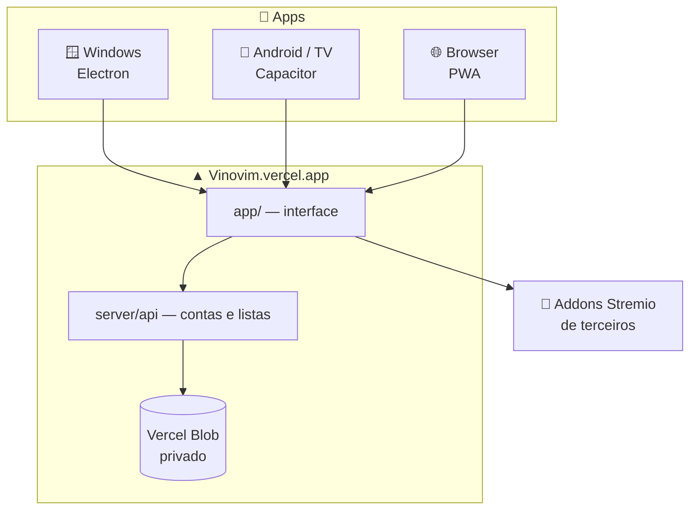

# 🏗️ Arquitetura do Vinovim

Este documento explica como as peças do Vinovim encaixam umas nas outras.

## 🧱 Visão geral



- A **interface** é a mesma em todas as plataformas: HTML, CSS e JavaScript simples, sem frameworks e sem passo de compilação.
- As apps de **Windows** e **Android** são “cascas” nativas que carregam a interface a partir do site (`config/remote.json`). Se não houver rede, usam a cópia que vem dentro da app.
- Os **addons** são chamados diretamente pela app. O site do Vinovim nunca vê nem guarda conteúdo.

## 🧩 A interface (`app/`)

A interface divide-se em duas partes:

- **`js/core/`** — o núcleo: estado, addons, vistas, página do título, leitor, perfis e navegação. Não sabe nada das funcionalidades extra.
- **`js/features/`** — cada ficheiro junta funcionalidades do mesmo tema e liga-se ao núcleo através de **pontos de extensão** (*hooks*). Cada um corre dentro da sua própria função, por isso não deixa variáveis soltas no espaço global.

Os estilos seguem a mesma divisão: `css/base.css` para o núcleo e um ficheiro por funcionalidade.

### 🪝 Pontos de extensão

O núcleo anuncia o que está a acontecer e as funcionalidades registam-se para reagir. Nenhuma funcionalidade substitui funções do núcleo.

```js
// núcleo (core/leitor.js)
function play(stream, ctx) {
  if (!hooks.allow('play:allow', stream, ctx)) return; // alguém pode impedir
  hooks.emit('play:start', stream, ctx);               // antes de começar
  startPlayback(stream, ctx);
  hooks.emit('play:started', stream, ctx);             // depois de começar
}

// funcionalidade (features/temas-e-extras.js)
hooks.on('play:allow', (stream, ctx) => {
  if (isKids() && kidOk(ctx.meta) === false) return false; // perfil infantil
});
```

| Função | Para quê |
|:--|:--|
| `hooks.on(nome, fn)` | registar uma função |
| `hooks.emit(nome, ...)` | avisar todas as funções registadas |
| `hooks.allow(nome, ...)` | perguntar se a ação pode continuar (`false` cancela) |
| `hooks.pipe(nome, valor, ...)` | passar um valor por todas as funções e usar o resultado |

Os principais:

| Hook | Quando |
|:--|:--|
| `boot` | a app acabou de arrancar |
| `save` | o estado foi guardado |
| `route`, `route:start`, `route:done` | navegação entre endereços (`#home`, `#lista=…`, `#comando=…`) |
| `view:<nome>:before`, `view:<nome>` | antes e depois de uma vista ser desenhada (`view:home`, `view:settings`…) |
| `detail:shown` | a página de um título abriu |
| `play:allow`, `play:start`, `play:started` | o leitor vai abrir / abriu |
| `player:closing`, `player:closed`, `player:menu` | o leitor vai fechar / fechou / o menu do leitor foi desenhado |
| `profile:switch`, `profile:saved` | mudou o perfil ativo / um perfil foi guardado |
| `sync:remote`, `sync:merged` | chegaram dados da conta / foram juntados com os deste aparelho |
| `card`, `catalog:extra`, `catalog:items`, `progress:image`, `offline` | transformar cartões, pedidos ao catálogo e mensagens |

As vistas novas registam-se com `defineView('calendar', fn)`, o que lhes dá automaticamente os mesmos hooks.

| Funcionalidade | O que traz |
|:--|:--|
| `conta.js` | Conta e sincronização, calendário, saltar introdução, estatísticas, ver em conjunto, listas, Chromecast, idiomas |
| `temas-e-extras.js` | Capas que faltavam, catálogo do perfil infantil, transferências, comando no telemóvel, voz, temas, mini-player, conquistas, importar Trakt e Letterboxd, gestor de addons |
| `listas-e-descoberta.js` | Próximo episódio automático, listas partilhadas, “Avisa-me”, início por perfil, “Não sei o que ver”, atalhos e comandos de jogos, cópia de segurança, página de ator, notas |
| `windows-e-resumo-anual.js` | Integração com o Windows (menu Iniciar, barra de tarefas) e o teu ano no Vinovim |
| `estilo-netflix.js` | Abertura animada, trailer no destaque, pré-visualizações, “% para ti”, Top 10, “Porque viste…”, Novidades |
| `navegacao.js` | Menu no topo, menu “Mais”, menu inferior no telemóvel, definições e biblioteca por separadores |
| `entrada.js` | Ecrã de entrada: Google, email ou continuar sem conta |
| `cinema-em-casa.js` | Ecrã de pausa, “Da última vez…”, continuar noutro dispositivo, início da época, contagem para estreias, protetor de ecrã |

### ✍️ Estilo do código

- JavaScript e CSS formatados com **Prettier** (`npm run format`, regras em `.prettierrc.json`).
- Comentários e textos da interface em **português de Portugal**.

## 💾 Onde ficam os dados

| O quê | Onde |
|:--|:--|
| Perfis, lista, progresso, preferências | `localStorage` → chave `vinovim.v1` (no próprio dispositivo) |
| Capas encontradas, cenas do “Continuar a ver” | `localStorage` → `vinovim.posters`, `vinovim.frames` |
| Transferências | `IndexedDB` |
| Conta sincronizada e cópias de segurança | `server/api/account.js` → Vercel Blob **privado** |
| “A ver agora” (para continuar noutro dispositivo) | `server/api/account.js?a=now` → Vercel Blob **privado** |
| Login com Google | `server/api/google.js` e `google-callback.js` (o Google confirma o token; não é preciso segredo) |
| Listas partilhadas | `server/api/lists.js` → Vercel Blob **privado**, protegidas por chave |

Os **PINs** dos perfis nunca são guardados em texto: só um *hash*.

## 🪟 Windows (`desktop/`)

- `main.js` cria a janela, carrega o site (ou a cópia local) e trata da integração com o sistema:
  - **Lista de atalhos** (“Continuar a ver”, Pesquisar, Biblioteca, Calendário);
  - **Botões na miniatura** da barra de tarefas e **progresso** no ícone;
  - **Discord Rich Presence** (opcional);
  - uma só instância da app.
- `preload.js` expõe à interface um objeto seguro, `window.vinovimNative`.

## 🤖 Android (`mobile/`)

O projeto Android é gerado pelo **Capacitor** durante a compilação. Depois, `mobile/android_widget.py` acrescenta:

- o widget **“Continuar a ver”** no ecrã inicial;
- a **atualização dentro da app** (descarrega o novo `.apk` e abre o instalador), em `mobile/android_update.py`;
- a **assinatura sempre com a mesma chave** (secret `VINOVIM_ANDROID_KEY`), para o Android aceitar as atualizações por cima;
- a atualização do widget ao sair da app;
- a permissão do microfone (pesquisa por voz);
- o suporte para **Android TV** (o passo está no workflow).

## 🔄 Atualizações

1. `version.json` diz qual é a versão atual e o que mudou.
2. A app compara-o com a sua versão (`APP_VERSION`) e mostra as **novidades**.
3. Se `native.min` for maior do que a versão da app instalada, pede para instalar a app nova (só acontece quando muda `desktop/` ou `mobile/`).
